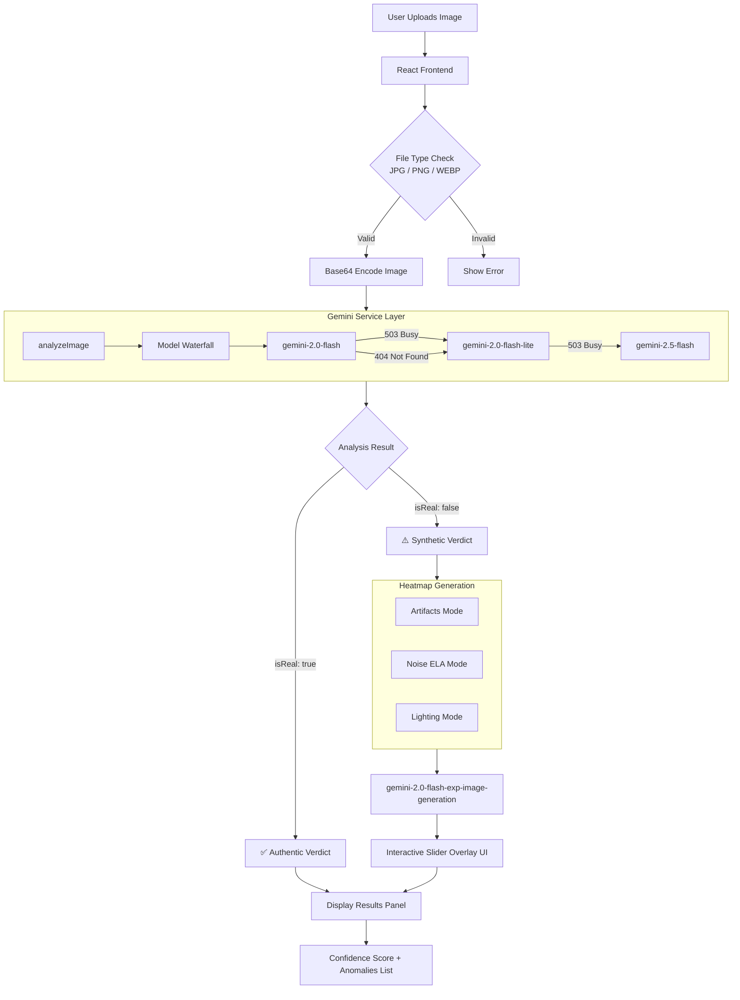

<div align="center">

# 🛡️ Guardian AI
### AI-Powered Deepfake Detection System

[](https://react.dev/)
[](https://www.typescriptlang.org/)
[](https://vitejs.dev/)
[](https://ai.google.dev/)
[](LICENSE)

**Guardian AI** is a real-time deepfake and AI-generated image detection system powered by Google Gemini's multimodal vision models. Upload any image and get an instant verdict — Authentic or Synthetic — with confidence score, source attribution, and advanced neural heatmap overlays.

[🚀 Live Demo](#) · [📖 Documentation](#architecture) · [🐛 Report Bug](issues) · [✨ Request Feature](issues)

---

</div>

## ✨ Features

| Feature | Description |
|---|---|
| 🔍 **Deep Scan Analysis** | Gemini multimodal AI analyzes pixel artifacts, lighting, and metadata |
| 🔥 **Neural Heatmaps** | 3 overlay modes: Artifact Detection, Noise Analysis, Lighting Consistency |
| 🎯 **Confidence Score** | Percentage confidence with source attribution (DSLR, Midjourney, etc.) |
| 🛡️ **Biometric Login** | Animated fingerprint scan authentication screen |
| 📱 **Responsive UI** | Works on desktop and mobile browsers |
| ⚡ **Model Waterfall** | Automatically falls back across Gemini models if one is busy |
| 🎨 **Dark Cyberpunk UI** | Glassmorphism design with smooth Framer Motion animations |

---

## 🏗️ Architecture



---

## 🤖 How the Model Works

### Step 1 — Image Preprocessing
The uploaded image is read as a `base64` data URL via the browser's `FileReader` API. The raw base64 payload (without the `data:image/...;base64,` prefix) is extracted and sent to the Gemini API as `inlineData`.

### Step 2 — Multimodal Analysis (`analyzeImage`)
The image is sent to a Gemini vision model with a structured prompt requesting a **JSON response** containing:
- **`isReal`** — boolean verdict
- **`confidence`** — float 0–1 (e.g. `0.94` = 94% confident)
- **`source`** — estimated origin (e.g. `"Stable Diffusion"`, `"Phone Camera"`)
- **`reasoning`** — natural language explanation of the decision
- **`metadata.artifacts`** — array of detected anomalies

The model inspects:
| Signal | What Gemini Checks |
|---|---|
| **Pixel Artifacts** | Blending seams, unnatural smoothness, GAN fingerprints |
| **Lighting Consistency** | Shadow directions, specular highlights, ambient occlusion |
| **Facial Geometry** | Eye symmetry, ear shape, hair strand generation patterns |
| **Metadata Signals** | EXIF-style compression patterns, upscaling artifacts |
| **Texture Naturalness** | Skin pores, fabric weave, background coherence |

### Step 3 — Heatmap Generation (Fake Images Only)
If the image is detected as synthetic, **3 heatmap overlays** are generated in parallel using `gemini-2.0-flash-exp-image-generation`:

```
┌─────────────────────────────────────────┐
│  Mode         │  What It Shows           │
├─────────────────────────────────────────┤
│  🔴 Artifacts │  GAN/diffusion seams,    │
│               │  red-yellow gradient     │
├─────────────────────────────────────────┤
│  🔵 Noise ELA │  Pixel noise patterns,   │
│               │  cyan-purple gradient    │
├─────────────────────────────────────────┤
│  ⚪ Lighting  │  Shadow inconsistencies, │
│               │  blue-white gradient     │
└─────────────────────────────────────────┘
```

The user can drag an **interactive slider** to compare the original image and any heatmap side-by-side.

### Step 4 — Model Waterfall (Reliability)
To handle API overload gracefully, the service tries models in order:

```
gemini-2.0-flash  →  gemini-2.0-flash-lite  →  gemini-2.5-flash
     ↓ 503                  ↓ 503
  wait 8s →            wait 8s →           surface error
```

---

## 📊 Sample Results

### Authentic Image
```json
{
  "isReal": true,
  "confidence": 0.96,
  "source": "DSLR Camera",
  "reasoning": "Natural bokeh, consistent Bayer noise pattern, authentic EXIF-like compression. Skin texture shows real pore structure. Lighting is physically plausible with single consistent source.",
  "metadata": {
    "artifacts": []
  }
}
```

### Synthetic / Deepfake Image
```json
{
  "isReal": false,
  "confidence": 0.91,
  "source": "Stable Diffusion",
  "reasoning": "Unnatural smoothness in skin regions. Ear geometry inconsistent with head angle. Background shows repetitive texture tiles. Hair strands merge unrealistically near the temples.",
  "metadata": {
    "artifacts": [
      "GAN smoothing in facial skin",
      "Inconsistent ear geometry",
      "Background tiling artifacts",
      "Unnatural hair generation near temples",
      "Specular highlights misaligned with lighting"
    ]
  }
}
```

---

## 🛠️ Tech Stack

| Layer | Technology |
|---|---|
| **Framework** | React 19 + TypeScript |
| **Build Tool** | Vite 6 |
| **Styling** | Tailwind CSS v4 |
| **Animations** | Framer Motion (motion/react) |
| **Icons** | Lucide React |
| **AI Model** | Google Gemini (`@google/genai` v1.29) |
| **File Upload** | react-dropzone |
| **Utilities** | clsx, tailwind-merge |

---

## 🚀 Getting Started

### Prerequisites
- **Node.js** v18 or higher
- A **Google Gemini API key** from [Google AI Studio](https://aistudio.google.com/apikey)

### Installation

```bash
# 1. Clone the repository
git clone https://github.com/YOUR_USERNAME/deepfake-guardian-ai.git
cd deepfake-guardian-ai

# 2. Install dependencies
npm install

# 3. Set up environment variables
cp .env.example .env.local
```

### Configuration

Open `.env.local` and add your Gemini API key:

```env
GEMINI_API_KEY="YOUR_API_KEY_HERE"
APP_URL="http://localhost:3000"
```

> **Get your API key**: Go to [aistudio.google.com/apikey](https://aistudio.google.com/apikey) → Click **"Create API key"**

### Running Locally

```bash
npm run dev
```

Open **http://localhost:3000** in your browser.

---

## 📁 Project Structure

```
deepfake-guardian-ai/
├── src/
│   ├── App.tsx              # Main application — Login + Dashboard UI
│   ├── main.tsx             # React entry point
│   ├── index.css            # Global styles + Tailwind config
│   ├── lib/
│   │   └── utils.ts         # cn() utility for class merging
│   └── services/
│       └── gemini.ts        # Gemini API service (analysis + heatmaps)
├── index.html               # HTML entry point
├── vite.config.ts           # Vite + env injection config
├── tsconfig.json            # TypeScript config
├── package.json             # Dependencies
├── .env.example             # Environment variable template
└── .gitignore               # Git ignore rules
```

---

## 🔑 Environment Variables

| Variable | Required | Description |
|---|---|---|
| `GEMINI_API_KEY` | ✅ Yes | Your Google Gemini API key |
| `APP_URL` | Optional | Base URL of your deployed app |

---

## ⚠️ API Rate Limits (Free Tier)

The free tier of Google AI Studio has the following limits:

| Model | Requests/Min | Requests/Day |
|---|---|---|
| `gemini-2.0-flash` | 15 RPM | 1,500 RPD |
| `gemini-2.0-flash-lite` | 30 RPM | 1,500 RPD |
| `gemini-2.5-flash` | 10 RPM | 500 RPD |

If you hit a rate limit, wait **60 seconds** and try again. The app automatically handles overload errors with a model fallback system.

---

## 🤝 Contributing

Contributions are welcome!

1. Fork the repository
2. Create a feature branch: `git checkout -b feature/my-feature`
3. Commit your changes: `git commit -m 'feat: add my feature'`
4. Push to the branch: `git push origin feature/my-feature`
5. Open a Pull Request

---

## 📄 License

This project is licensed under the MIT License. See [LICENSE](LICENSE) for details.

---

<div align="center">
Built with ❤️ using <a href="https://ai.google.dev/">Google Gemini AI</a> · <a href="https://react.dev/">React</a> · <a href="https://vitejs.dev/">Vite</a>
</div>
