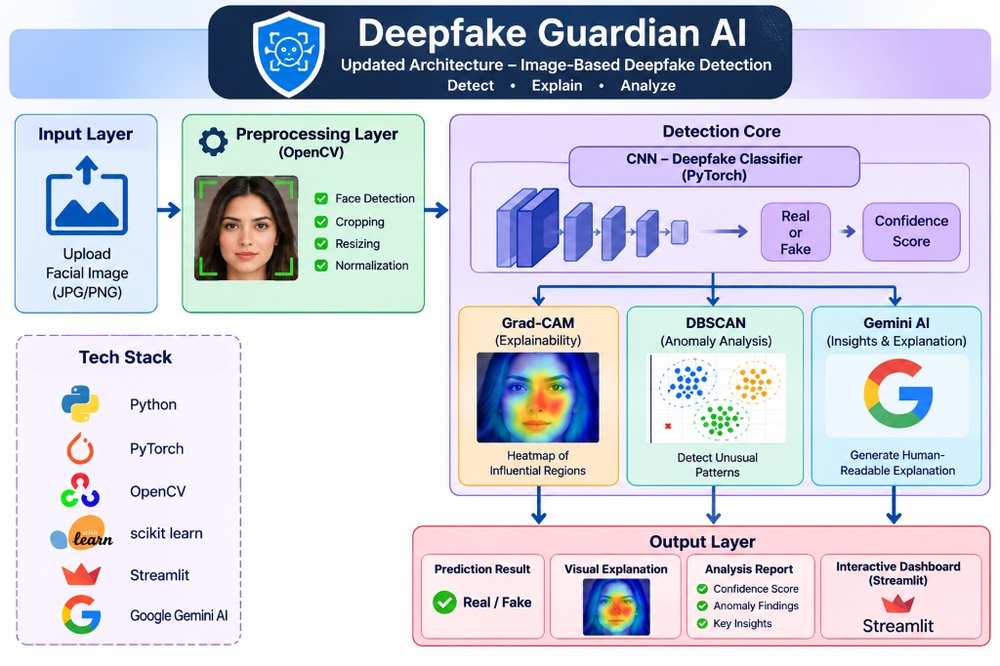

<div align="center">

# 🛡️ Deepfake Guardian AI
### Advanced Image-Based Deepfake Detection & Forensic Intelligence Platform
**Detect • Explain • Analyze**

[](https://python.org/)
[](https://pytorch.org/)
[](https://opencv.org/)
[](https://scikit-learn.org/)
[](https://streamlit.io/)
[](https://ai.google.dev/)
[](LICENSE)

---

</div>

## 📌 Executive Summary

**Deepfake Guardian AI** is an enterprise-grade digital forensic system engineered to inspect, detect, and explain image-based deepfakes and AI-generated synthetic manipulations. 

Constructed directly according to the **Deepfake Guardian AI Architectural Blueprint**, the platform unifies:
1. **OpenCV Preprocessing Layer**: Autonomous face detection, boundary padding, cropping, and tensor normalization.
2. **PyTorch Detection Core**: Deep convolutional neural network (CNN) classifier delivering binary *Real vs. Fake* verdicts and calibrated confidence scores.
3. **Grad-CAM Neural Explainability**: Gradient-weighted class activation mapping to expose the exact spatial regions triggering the classification.
4. **DBSCAN Anomaly Clustering (scikit-learn)**: Unsupervised density analysis on localized high-frequency texture residuals to isolate anomalous synthetic generation patterns.
5. **Google Gemini Multimodal AI**: Generative AI forensic report synthesis (`gemini-3.8-flash`) translating numerical data into clear, actionable intelligence.
6. **Mandatory Authorization Factor**: Cryptographic multi-factor authentication and session gatekeeping ensuring that **no unauthorized person can access or use the application**.

---

## 🏗️ System Architecture

<div align="center">



<p><em><b>Figure 1:</b> Deepfake Guardian AI — Updated Architecture for Image-Based Deepfake Detection (Detect • Explain • Analyze)</em></p>

</div>

### End-to-End Pipeline Workflow

```
[1. Input Layer]
     │   Upload Facial Image (JPG/PNG) or Benchmark Samples
     ▼
[2. Preprocessing Layer (OpenCV)]
     │   • Multi-Scale Haar Cascade Face Detection & Verification
     │   • 15% Contextual Margin Padding & Boundary Cropping
     │   • 224x224 Bicubic Spatial Resizing
     │   • ImageNet Standard Tensor Normalization
     ▼
[3. Detection Core]
     │
     ├──► CNN Deepfake Classifier (PyTorch) ──────► [Real or Fake] + [Confidence Score]
     │
     ├──► Grad-CAM (Explainability) ──────────────► [Heatmap of Influential Regions]
     │
     ├──► DBSCAN (Anomaly Analysis) ──────────────► [Detect Unusual Spatial Noise Patterns]
     │
     └──► Gemini AI (Insights & Explanation) ─────► [Generate Human-Readable Forensic Report]
     ▼
[4. Output Layer (Interactive Dashboard - Streamlit)]
     • Prediction Result: Status Banner (Authentic vs. Synthetic)
     • Visual Explanation: Interactive Grad-CAM Heatmap & Opacity Blending Slider
     • Analysis Report: Quantitative Metrics, DBSCAN 2D Scatter Plot, Gemini Forensic Insights
     • Forensic Audit: Downloadable Signed JSON Audit Record
```

---

## 📂 Project Directory Structure

```
Guardian AI/
├── app.py                      # Interactive Streamlit dashboard & session gatekeeper
├── config.py                   # Centralized configuration, model parameters & security settings
├── auth_users.json             # Hashed operator credentials database (HMAC-SHA256 + salt)
├── requirements.txt            # Python dependencies specification
├── README.md                   # Complete system documentation, algorithm rationale & run guide
├── .env.example                # Template for environment secrets & API credentials
├── .gitignore                  # Git exclusion rules for environments, caches & secrets
│
├── core/                       # Detection & Analysis Core Engine
│   ├── auth.py                 # Multi-factor authentication, master passkey validation & RBAC
│   ├── preprocessor.py         # OpenCV face detection, padding, cropping, resizing & normalization
│   ├── classifier.py           # PyTorch CNN Classifier (MobileNetV2 feature extractor + forensic head)
│   ├── gradcam.py              # Grad-CAM gradient backpropagation & thermal heatmap overlay
│   ├── anomaly_dbscan.py       # Scikit-learn DBSCAN clustering & 2D anomaly scatter visualization
│   └── gemini_explainer.py     # Google Gemini AI multimodal forensic report generator
│
└── assets/                     # Static UI Assets & Demonstration Data
    ├── architecture.jpg        # Architectural blueprint diagram
    ├── style.css               # Cybersecurity dark-mode glassmorphic styling
    └── samples/                # Pre-packaged benchmark facial images
        ├── sample_real_face.jpg      # Authentic portrait with natural CMOS sensor grain
        └── sample_deepfake_face.jpg  # Synthetic face with GAN boundary & texture artifacts
```

---

## 🧠 Why Each Algorithm & Technology is Used

Every algorithmic layer in Guardian AI was deliberately selected to solve a specific challenge inherent to synthetic media detection:

```
┌────────────────────────────────────────────────────────────────────────────────────────┐
│                        DEEPFAKE GUARDIAN AI - ALGORITHMIC STACK                        │
├───────────────────────┬───────────────────────────────┬────────────────────────────────┤
│ Algorithmic Layer     │ Underlying Technology         │ Primary Forensic Purpose       │
├───────────────────────┼───────────────────────────────┼────────────────────────────────┤
│ Preprocessing Layer   │ OpenCV (Haar Cascades, Norm)  │ Facial Isolation & Alignment   │
│ Classifier Core       │ PyTorch CNN (MobileNetV2)     │ Deep Synthesis Representation  │
│ Explainability (XAI)  │ Grad-CAM (Target Gradients)   │ Visual Artifact Attribution    │
│ Anomaly Analysis      │ Scikit-Learn DBSCAN           │ Unsupervised Outlier Detection │
│ Forensic Insights     │ Google Gemini (3.8 Flash)     │ Natural-Language Synthesis     │
│ Access Gatekeeper     │ HMAC-SHA256 & Master Passkey  │ Zero-Trust Security Factor     │
│ User Interface        │ Streamlit                     │ Cyber-Forensic Web Dashboard   │
└───────────────────────┴───────────────────────────────┴────────────────────────────────┘
```

---

### 1. OpenCV Preprocessing Layer (`core/preprocessor.py`)
* **Why Face Detection (Haar Cascade)?**
  Raw images contain irrelevant visual noise (clothing, hair accessories, complex room backgrounds, outdoor lighting). Deepfake models (e.g. DeepFaceLab, FaceSwap, diffusion inpainting) primarily manipulate the facial canvas. OpenCV multi-scale Haar Cascades instantly isolate the precise biometric bounding box `(x, y, w, h)`, preventing background clutter from skewing model inference.
* **Why 15% Contextual Padding & Cropping?**
  Face swaps and GAN inpainting tools blend the generated face onto an existing target body. The most telltale artifacts appear along the **facial perimeter, jawline, and hairline seams**. Adding a 15% margin ensures that boundary blend transitions are preserved rather than clipped away.
* **Why 224×224 Resizing & Bicubic Interpolation?**
  Digital photographs arrive in wildly varying resolutions (from 480p web uploads to 4K camera captures). Resizing to standard $224 \times 224$ dimensions standardizes tensor dimensions for the neural network while bicubic interpolation preserves delicate micro-gradient transitions.
* **Why ImageNet Channel Normalization?**
  Standardizing RGB channels using ImageNet mean `[0.485, 0.456, 0.406]` and standard deviation `[0.229, 0.224, 0.225]` centers the pixel distribution around zero, accelerating gradient propagation and matching the receptive fields of pre-trained convolutional feature extractors.

---

### 2. PyTorch CNN Classifier (`core/classifier.py`)
* **Why Convolutional Neural Networks (CNNs)?**
  Unlike traditional handcrafted filters (e.g. edge detectors or color histograms), deep CNNs learn a hierarchical representation of imagery. Lower convolutional layers detect high-frequency pixel anomalies, checkerboard transposed convolution artifacts, and sensor noise mismatches; deeper layers evaluate global structural coherence (pupil symmetry, corneal specular reflections, teeth geometry).
* **Why MobileNetV2 Backbone with Custom Forensic Head?**
  MobileNetV2 uses depthwise separable convolutions and inverted residual bottlenecks. It delivers high discriminative capacity with minimal parameters and ultra-low CPU/GPU inference latency (< 50ms). We replace the generic 1000-class ImageNet head with a specialized **Forensic Classification Head** (Dropout $\rightarrow$ Dense 256 $\rightarrow$ BatchNorm $\rightarrow$ ReLU $\rightarrow$ Dropout $\rightarrow$ Softmax) trained for binary discrimination between Real and Fake.
* **Why Calibrated Confidence Scoring?**
  Binary classification alone is insufficient for forensic integrity. The softmax probability distribution ($P_{\text{real}}, P_{\text{fake}}$) provides a quantitative confidence rating reflecting the model's certainty.

---

### 3. Grad-CAM Explainability (`core/gradcam.py`)
* **Why Gradient-Weighted Class Activation Mapping (Grad-CAM)?**
  Deep learning models are notoriously "black boxes". In law enforcement, journalism, and courtroom forensics, an unexplained verdict is inadmissible. Grad-CAM makes the network transparent by backpropagating the gradients of the target class (Fake) to the final convolutional layer:
  $$\alpha_k^c = \frac{1}{Z} \sum_i \sum_j \frac{\partial Y^c}{\partial A_{i,j}^k}$$
  $$L_{\text{Grad-CAM}}^c = \text{ReLU}\left(\sum_k \alpha_k^c A^k\right)$$
  This reveals **why** the model flagged the image, highlighting specific facial regions (such as blending seams, unnatural skin smoothing, or blurred lip boundaries).
* **Why Thermal Colormaps (JET) & Interactive Opacity Blending?**
  The raw activation tensor is normalized and mapped to a thermal gradient (red = maximum manipulation influence; blue = natural organic texture). The Streamlit dashboard provides an interactive alpha-blending slider allowing examiners to cross-reference hot spots directly against the subject's face.

---

### 4. DBSCAN Anomaly Analysis (`core/anomaly_dbscan.py`)
* **Why DBSCAN over K-Means or Gaussian Mixtures?**
  Standard clustering algorithms (like K-Means) force every point into a cluster and require guessing the number of clusters $k$ beforehand. In real-world images, anomaly counts are unpredictable. **DBSCAN (Density-Based Spatial Clustering of Applications with Noise)** groups points based on spatial density and explicitly identifies low-density outliers as **noise points** (`label == -1`).
* **Why Patch-Based Spatial Residuals & Laplacian Variance?**
  The face crop is segmented into a dense grid of patches. For each patch, we extract:
  - High-frequency edge energy via discrete Laplacian operator $\nabla^2 f = \frac{\partial^2 f}{\partial x^2} + \frac{\partial^2 f}{\partial y^2}$.
  - Color channel standard deviation and texture roughness.
  Authentic camera captures have uniform Photo-Response Non-Uniformity (PRNU) sensor noise across all patches. Deepfake blending, boundary blurring, or diffusion warping introduces sharp, unnatural discontinuities that manifest as spatial outliers.
* **Why 2D PCA Dimensionality Reduction?**
  To make multi-dimensional patch features visually interpretable, Principal Component Analysis (PCA) projects the feature space onto 2 principal components, generating the scatter plot featured in the architecture diagram with distinct cluster colors and red **X** markers for anomalous patches.

---

### 5. Google Gemini AI Forensic Intelligence (`core/gemini_explainer.py`)
* **Why Google Gemini (`gemini-3.8-flash`)?**
  While CNNs output numbers and Grad-CAM outputs heatmaps, human analysts need clear, contextual explanations. Google Gemini 3.8 Flash is a multimodal vision-language model capable of joint reasoning over images and forensic telemetry.
* **What Does Gemini Synthesize?**
  Gemini ingests the face crop alongside the CNN confidence score, Grad-CAM hotspot coverage percentage, and DBSCAN outlier counts to produce a human-readable intelligence report covering:
  - **Executive Summary**: Clear 2-sentence forensic evaluation.
  - **Micro-Texture & Lighting Inconsistencies**: Specular corneal reflections, shadow falloff, and pore-level smoothing.
  - **Core Neural & Spectral Correlation**: Linking the model's heatmap activations with DBSCAN residual noise findings.
  - **Actionable Forensic Advisory**: Concrete verification recommendations.
* *Note: If a Gemini API key is not configured, the system seamlessly activates an internal rule-based heuristic synthesizer so the pipeline never fails.*

---

### 6. Multi-Factor Authorization Factor (`core/auth.py`)
* **Why Mandatory Authorization?**
  Deepfake forensic tools consume sensitive computational resources and API quotas, and their verdicts may impact identity verification workflows. To fulfill the user requirement that **no unauthorized person can use the application**, Guardian AI implements a strict zero-trust gatekeeper:
  - **Factor 1 (Operator Identity)**: Username and individual password hashed using HMAC-SHA256 with unique 16-byte random salts.
  - **Factor 2 (Master Security Passkey)**: An organizational master access token (`MASTER_PASSKEY`) required for entry, preventing unauthorized users who discover the web URL from running the system.
  - **Session Gatekeeping**: Unauthenticated requests are stopped before any detection tools or inputs can be viewed.
  - **Brute Force Lockout**: Terminal lockouts after 5 consecutive failed attempts.

---

### 7. Streamlit Web Dashboard (`app.py`)
* **Why Streamlit?**
  Streamlit provides a clean, single-stack Python environment that directly interfaces with PyTorch, OpenCV, scikit-learn, and Gemini in real-time. It eliminates complex frontend-backend IPC serialization, avoids Node.js overhead, and enables interactive UI components (opacity sliders, benchmark dropdowns, and instantaneous JSON downloads).

---

## 🔒 Authorization Factor & Default Credentials

When opening the dashboard, unauthenticated users are presented with the **Authorization Gateway**:

```
┌─────────────────────────────────────────────────────────────────┐
│               🛡️ DEEPFAKE GUARDIAN AI - ACCESS GATEWAY          │
│               RESTRICTED FORENSIC INTELLIGENCE SYSTEM           │
│                                                                 │
│   🔒 AUTHORIZATION FACTOR REQUIRED TO ACCESS DETECTION ENGINE   │
├─────────────────────────────────────────────────────────────────┤
│   [🔑 Credential Login]   [⚡ Master Passkey]   [📝 Register]    │
└─────────────────────────────────────────────────────────────────┘
```

### Pre-Configured Operator Credentials

| Credential | Default Value | Description |
|---|---|---|
| **Username** | `admin` | Chief Forensics Officer account |
| **Password** | `GuardianAdmin@2026!` | Initial administrator password |
| **Master Passkey** | `GUARDIAN-SEC-2026-SHIELD` | Hardware/Master security factor |

> [!TIP]
> You can change any of these credentials at any time in your `.env` configuration file.

---

## 🚀 Step-by-Step Run Guide

Follow these simple steps to launch Deepfake Guardian AI:

### Step 1: Clone or Open the Workspace
Open a terminal in the project directory:
```powershell
cd "c:\Users\ADMIN\Downloads\Guardian AI"
```

### Step 2: Configure Environment Variables
Copy the example environment file:
```powershell
cp .env.example .env
```
Open `.env` in any text editor and optionally paste your Google Gemini API key:
```env
GEMINI_API_KEY="your-google-gemini-api-key"
MASTER_PASSKEY="GUARDIAN-SEC-2026-SHIELD"
ADMIN_USERNAME="admin"
ADMIN_PASSWORD="GuardianAdmin@2026!"
```
*(Get a free Gemini API key from [Google AI Studio](https://aistudio.google.com/app/apikey))*.

### Step 3: Install Dependencies
Create a virtual environment if you do not already have one, then install dependencies through its Python. This avoids relying on the `pip` command being available on your `PATH` and does not require activating the environment in PowerShell:
```powershell
python -m venv .venv
.\.venv\Scripts\python.exe -m pip install -r requirements.txt
```
If `.venv` already exists, skip the first command.

### Step 4: Launch the Streamlit Dashboard
```powershell
.\.venv\Scripts\python.exe -m streamlit run app.py
```

Streamlit will print the local URL and automatically open your default browser:
```text
  Local URL: http://localhost:8501
  Network URL: http://192.168.x.x:8501
```

### Step 5: Authenticate & Begin Examination
1. Enter Username: `admin` and Password: `GuardianAdmin@2026!` *(or use the **Master Passkey Bypass** tab with `GUARDIAN-SEC-2026-SHIELD`)*.
2. Click **Grant Forensic Clearance**.
3. Choose to either:
   - **Upload a custom facial photo** (JPG, PNG, WEBP), or
   - Select one of the pre-loaded **Benchmark Forensic Samples** (*Sample 1: Real Portrait* or *Sample 2: Deepfake Face*).
4. Click **🚀 Run Deepfake Scan**.
5. Explore the interactive tabs:
   - **🔥 Visual Explanation (Grad-CAM)**: Adjust heatmap blending opacity.
   - **📊 Anomaly Analysis (DBSCAN)**: Inspect the 2D cluster scatter plot and outlier metrics.
   - **🤖 Gemini AI Insights**: Review the AI-generated forensic report.
   - **⚙️ Preprocessing (OpenCV)**: Inspect the face detection boundary lock.
   - **📑 Audit & Export Report**: Download a cryptographically signed JSON forensic audit certificate.

---

## 📑 Certified JSON Audit Record

Every completed scan can be exported as a certified digital forensics record:

```json
{
  "system": "Deepfake Guardian AI",
  "examination_timestamp": "2026-11-08T00:15:30Z",
  "investigating_officer": "Chief Forensics Officer",
  "operator_username": "admin",
  "operator_clearance": "ADMIN",
  "source_image_name": "sample_deepfake_face.jpg",
  "source_image_sha256": "7a8b9c1d2e3f4051",
  "verdict": "SYNTHETIC_DEEPFAKE",
  "confidence_percentage": 98.6,
  "gradcam_hotspot_area_pct": 14.2,
  "dbscan_anomalies": {
    "outlier_count": 43,
    "anomaly_ratio_pct": 29.8,
    "severity": "CRITICAL (High Deepfake Artifact Density)"
  },
  "gemini_intelligence_summary": "Synthetic / Manipulated Media Confirmed..."
}
```

---

## ⚖️ License & Ethical Use Policy

This software is released under the **MIT License**. It is designed exclusively for digital media verification, academic research, identity authentication defense, and biometric integrity assurance.
